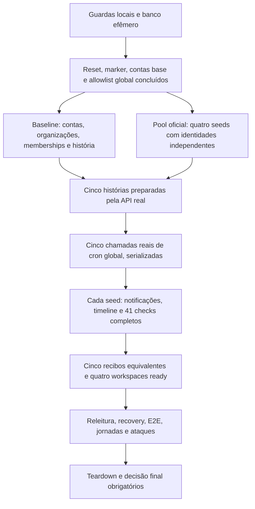

# Preparação coordenada dos cinco seeds reais

Checkpoint iniciado em 04/11/2026, atualizado com a primeira execução real
de 05/11. Run `42045660105`, HEAD `ee3eb2ae`: seed/pool/sanity/recovery/E2E da
Demo passaram; o run completo falhou nos testes de fixture de URL e na jornada
nova de portfólio, corrigidos na candidata posterior. Não é prova de release.
Base #327, run `41936120694`, HEAD `34d5baf5`, candidato de merge `32a1a944`.
Tempo total observado: 26,65 min; integração: aproximadamente 26,3 min.
O ganho de browser da #327 já é real nesse run. Não prova repetibilidade,
custo equivalente em runner-minutes ou qualquer estado hospedado.

## Gargalo medido

O artefato oficial contém seis perfis: baseline/reset, baseline/check e quatro
workspaces. Baseline: 611,26 s, 669 tentativas HTTP instrumentadas, 18,38 s de
HTTP (incluindo consumo das respostas), 58,63 s de espera narrativa e **534,01 s
de backpressure real**. Os workspaces levaram 617,33–617,68 s cada, em paralelo,
com 670 tentativas e uma espera de 530–533 s cada.

Cada gestora financeira fez 83 tentativas de escrita pela API, incluindo o
retry; o único 429 surgiu em `POST spend/reconcile`, na etapa `seedSpend`.
O limite existente é 60 escritas/600 s por usuário. Sem mudar os comandos ou a
história, retirar apenas sleeps não elimina essa janela. O pipeline anterior
pagava duas janelas em sequência: baseline e depois o pool. Os perfis não
incluíam o PUT de bytes no Storage e a chamada de cron; não atribuir seus tempos
às métricas HTTP antigas. O novo cron também passa pelo profiler.

## Primeira medição real da coordenação

Timestamps oficiais: antes, seed 613 s + provisionamento/verificação do pool
619 s = 1.232 s; agora, cinco seeds coordenados 628 s + verificação 1 s =
629 s. São **603 s a menos (48,94%) nesse trecho**, sem atribuir à verificação
de 1 s o custo de provisionamento já incluído nos 628 s. Sanity read-only
separado: 4→5 s. Ainda não é duração de uma execução integral aprovada.

Os cinco perfis passaram 41/41 checks com o mesmo hash: 205 no conjunto, mais
41 na releitura. Cada história manteve 293 tentativas app e 20 Auth; REST
356 no baseline/357 em cada workspace, iguais à referência. O profiler novo
acrescenta 30 PUTs de Storage e cinco chamadas de cron anteriormente não medidos.
Um 429 por história permaneceu, com espera real ~528–529 s; o baseline durou
626,76 s e os workspaces 624,26–624,43 s. Ganho veio da sobreposição, não da
remoção da quota ou de uma história abaixo de cinco minutos. Artefato oficial
e seu SHA, perfis compactos, limites e falhas posteriores estão em
`ops/ci/acceleration-v8/first-seed-proof.json`.

## DAG e fronteiras

Dentro de cada história a sequência canônica permanece: contas → organizações
e membros → instituições → RFQs/convites/propostas → aprovações/decisões →
contratos/documentos/tarefas → lifecycle/CRM. Não se paralelizam operações
dependentes nem se troca o autor para escapar da quota. Somente os cinco
escopos já independentes são sobrepostos.

O cron é global: executá-lo enquanto outro seed ainda cria dados alteraria a
ordem da manutenção. Por isso há barreira explícita antes dos crons. As cinco
chamadas anteriores são preservadas, agora serializadas com resultado 200,
`ok=true` e quatro jobs `succeeded`; 202/busy não equivale a manutenção concluída.
O baseline sinaliza o término dos crons; visitantes só então continuam.

## Provas e falhas

`seed-pool.mjs` chama os executáveis oficiais: baseline `seed.mjs --reset` e
`workspaces.mjs provision --count=4 --concurrency=4`. Não copia banco, não usa
service role para dados de negócio e não afrouxa API/Auth/RLS/quotas/Retry-After.
Há cinco processos de seed ativos, frente aos quatro do pool anterior; memória,
locks e estabilidade sustentada ainda exigem repetição no candidato corrigido;
a duração inicial real está registrada acima.

Os cinco JSONs devem ter resultado PASS, fase sanity PASS e os mesmos **41**
checks da baseline real #327. O hash usa apenas nomes normalizados dos checks,
sem valores/IDs/linhas. `seed-sanity-contract.json` fixa a origem desse contrato.
Ausência, duplicidade, checks reduzidos ou hash diferente falham a coordenação.
Releitura do baseline, capacidade/isolamento dos quatro workspaces e todo o
restante da integração continuam obrigatórios.

Coordenação só é aceita em Demo loopback, com marker confirmado, cron configurado,
diretório privado do próprio usuário e estado novo por execução. Não há modo
hospedado. Falha de qualquer processo aborta os grupos próprios, remove barreiras
e mantém a falha; timeout é limitado. O teardown da stack continua obrigatório.

Testes locais usam filhos sintéticos para ordenação, falha, cleanup, rejeição
hospedada e recibos incompletos. Não são prova de API/Auth/Storage reais. O CI
do candidato corrigido deverá ratificar equivalência e ganho; o limite de 10 min por
história pode permanecer, ainda que a sobreposição reduza o caminho crítico.
Não declarar seed/pool abaixo de cinco minutos sem medição correspondente.

`profile-report.mjs` gera HTML autossuficiente por fase, recurso/papel e espera.
Tempos de fases são inclusivos e somas de workspaces não são wall-clock do pool.
O relatório separa espera solicitada/real e não publica payloads nem credenciais.
